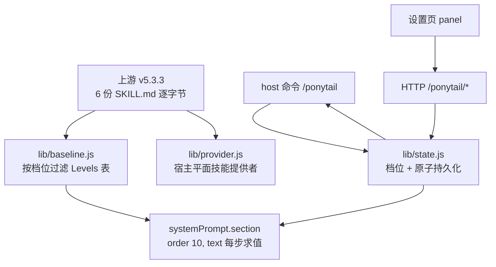

# dsh-ponytail-v6

> Ponytail 的 **DeepSeek Harness 原生移植**：上游 v5.3.3 的规则集与 6 个技能**逐字节保留**，外加 DSH 独有的**实时档位切换**（off / lite / full / ultra）。
>
> 不注册任何 tool，不碰你的 `AGENTS.md`，不改模型路由。零运行时依赖。

[English summary](#english-summary) · [设计文档](docs/DESIGN.md) · [能力清单](docs/CAPABILITIES.md) · [验收说明](docs/ACCEPTANCE.md)

---

## 它解决什么问题

上游 ponytail 在 DSH 上只到「指令层」：把 `AGENTS.md` 塞进会话，把技能拷到 `~/.agents/skills`，然后**没有档位、没有实时切换、没有 hooks**。已有两个第三方移植又各缺一半：

| | 6 技能齐全 | 内容为 v5 | 每步生效 | 即时切档 | 原生 UI |
|---|---|---|---|---|---|
| `gongyijie85/dsh-ponytail` | ✅ | ❌ 冻结在 v4（review/audit 与当前版本相似度仅 3.6%/4.1%） | ❌ | ❌ | ❌ |
| `HB123X/dsh-ponytail` | ❌ 无技能 | ❌ 重写且把 ultra 语义做反 | ✅ | ✅ | ⚠️ 手写 CSS |
| **本插件** | ✅ | ✅ | ✅ | ✅ | ✅ |

## 装法

```bash
# 从 GitHub
dsh plugin --profile web add github:ZhangYunfang/dsh-ponytail-v6

# 或从本地检出
dsh plugin --profile web add /path/to/dsh-ponytail-v6
```

装完**重启 DSH**（插件在进程启动时加载）。判据：

```bash
dsh --profile web --dump-config | grep -A2 ponytail
# 应出现一层 `# == dsh-ponytail-v6`
```

卸载：`dsh plugin --profile web remove dsh-ponytail-v6`

## 怎么用

| 入口 | 用法 |
|---|---|
| **命令** | `/ponytail` 看当前档位；`/ponytail lite` / `full` / `ultra` / `off` 切换 |
| **设置页** | 设置 → Ponytail：四个档位按钮 + 总开关 |
| **技能** | `/ponytail-review`、`/ponytail-audit`、`/ponytail-debt`、`/ponytail-gain`、`/ponytail-help` |
| **自然语言**（默认关闭，需 `PONYTAIL_PRE_STEP=1`） | 整条消息只发 `stop ponytail` 或 `normal mode` 即关闭（**仅当整条消息就是这句**）。默认关闭的原因见 [`lib/prestep.js`](lib/prestep.js) 顶部注释：它挂在 `agent/pre-step` waterfall 上，写错会让每一步都挂 |

> 注意：`/ponytail` 这个短名归 host 命令用（DSH 规则是「同名命令优先于技能手势」），核心规则本身已常驻，不需要手动加载。

### 四档语义

| 档位 | 行为 |
|---|---|
| `off` | 完全不注入，等于没装（技能仍可手动调） |
| `lite` | 照你说的做，一句话点出「还有个更小的做法」，由你选 |
| `full`（默认） | 六阶阶梯：平台原生 → 标准库 → 仓库已有 → 已装依赖 → 一行 → 最小代码 |
| `ultra` | 在 full 之上**额外质疑需求本身** |

⚠️ `ultra` 是与上游一致的「**更会拦**」，不是 HB123X 版那种「永不追问、直接给最短」。验收里有一条专门防这个回退。

## 档位默认值怎么定

优先级（高 → 低）：

1. 环境变量 `PONYTAIL_DEFAULT_MODE`
2. `~/.dsh/ponytail/config.json` 的 `mode`
3. `full`

运行时切换会写进 `config.json`（原子写：临时文件 + rename）。注意：**设了环境变量后它每次启动都赢**，命令切换只影响当前进程——这是上游行为，不是 bug。

## 它怎么工作



四个接缝全是 DSH 公开 API：

- `ctx.systemPrompt.section({ name, order, text: () => string })` —— `text` 每次组装求值。**同一档位下文本完全相同 → 提示前缀不变 → 缓存命中**；切档才变一次。
- `ctx.skills.registerProvider(...)` —— 注册在宿主平面，所有 agent preset 都能看到这 6 个技能。
- `ctx.commands.register(...)` —— 命令**不发给模型**，所以切档零 token。
- `ctx.slots.inject('settings.section', ...)` —— 设置页面板（可选增强；挂了也不影响前三个）。

`order = 10`：紧接 `DEPLOYMENT_PERSONA (0)` 之后、`PLAN_POLICY (500)` 之前，让工程规则读起来像人设的一部分，而不是工具文档。

规则文本的**单一真相源**是 `skills/ponytail/SKILL.md`；`lib/baseline.js` 只做过滤与拼接，不复制规则本体（上游自己警告过「同一逻辑写两处 = 两个 bug」）。

## 与工作区指令的关系

基线文本末尾固定写死一段**工作区优先条款**：`AGENTS.md`、项目规则以及它们要求的门禁/检查，与本块冲突时一律以工作区为准；本块不能用来当跳过门禁的理由。

这条是本移植新增的（上游宿主没有硬门禁）。如果项目里有 `verify_*.py` 之类的强制门禁，它不会被「懒惰」绕过。

## 成本（实测，不是宣传数字）

| 项 | 实测 |
|---|---|
| `full` 基线 | 约 706 token；`lite` 719；`ultra` 722；`off` 0 |
| 技能目录 | 约 400 token（6 个描述合计 1584 字符，均在 DSH 500 上限内） |
| 每步开销 | **0**（档位不变 → 前缀不变 → 缓存命中） |
| 切档开销 | 一次缓存失效（你主动操作） |

关于上游宣称的「成本 −26%」：本机实测一场 79 步会话，成本构成是**缓存读取 72% / 未命中输入 20% / 输出 7.9%**，输出只占总 token 的 0.27%。所以**靠"少写代码"省的钱是个位数百分比**；上游那 26% 的真实归因是**轮次少了 22%**（少返工、少来回）。详见 [docs/CAPABILITIES.md](docs/CAPABILITIES.md) §8。

**本插件的真实价值在代码质量与可维护性**，以及「代码更少 → 以后每次读的上下文更少」的复合收益。

## 验证

```bash
npm run verify   # 78 静态 + 37 宿主探针 + 22 客户端探针
npm test         # 26 个单元测试
```

`npm run verify` 跑三层，全部可复跑：

1. **静态验收**（`scripts/verify.mjs`，78 项）：技能 sha256 与 `upstream.lock.json` 全等、名字合法、描述不超预算、provider 能列出并加载 6 个技能、四档文本互异、`full` 保留四大条款、`ultra` 不出现 HB 的反转、档位解析四层、`stop ponytail` 不误触发、命令解析、工作区条款不被过滤掉。
2. **宿主契约探针**（`scripts/probe-host.mjs`，37 项）：用**真实 cordis + 真实 SystemPrompt + 真实 WebServer** 挂载本插件，验证 prompt 真的进了组装结果、切档实时生效、HTTP API 全状态码正确、关闭后 section 真的消失，以及 **5 种 scope 形状都能拿到规则集**（子代理继承）。
3. **客户端探针**（`scripts/probe-client.mjs`，22 项）：按 DSH 加载器信封加载浏览器半，用**真实 React 18.3.1 + react-dom/server** 渲染设置页面板，并把面板自己的 `readState()`/`post()` 打到宿主半的真实 WebServer 上验四种交互。

两个探针都把 `DSH_HOME` 指向临时目录，**跑验证不会写你的 `~/.dsh`**，也不启动 dsh-web。

## 跟随上游

```bash
npm run sync-upstream          # 拉上游 → 覆盖 skills/ → 重算 lock → 跑 verify
UPSTREAM_REPO=git@github.com:DietrichGebert/ponytail.git npm run sync-upstream
```

`upstream.lock.json` 记录上游版本、commit 与每个技能文件的 sha256，所以「逐字节」是可验证的，不是口号。

## 已知边界

- 面板的**视觉效果**（配色、间距、暗色主题下的观感）没有截图证据；已验证的是「能加载、能注册、能渲染出正确结构、交互函数与宿主一致」。
- `stop ponytail` 自然语言触发**默认关闭**（`PONYTAIL_PRE_STEP=1` 开启）。它挂在 `agent/pre-step` waterfall 上，v1.1.0 曾因写错这一步让每次对话都失败，详见 CHANGELOG；日常用 `/ponytail off` 即可。
- 兼容矩阵目前只声明 `0.1.2-alpha.2`（本机实测）。其它版本未验证就不写。
- 探针证明的是**契约匹配**，不等于「真的挂进了正在跑的 dsh-web」——那一步需要安装 + 重启，见 [docs/ACCEPTANCE.md](docs/ACCEPTANCE.md) §3。

## 许可

MIT。插件代码 © ZhangYunfang；规则与技能正文 © Dietrich Gebert（上游 MIT）。**非官方移植，与上游作者无隶属关系。**

---

## English summary

A DeepSeek Harness port of [ponytail](https://github.com/DietrichGebert/ponytail): the upstream v5.3.3 ruleset and all six skills are shipped **byte-for-byte** (`upstream.lock.json` records their sha256), plus what upstream cannot offer on DSH — live intensity switching.

- **Four seams, all public DSH APIs**: `systemPrompt.section` (re-evaluated per assembly, so an unchanged level keeps the prompt prefix identical and the KV cache warm), `skills.registerProvider` (host plane, so every preset sees the skills), `commands.register` (`/ponytail [level]`, never reaches the model, zero tokens), `slots.inject('settings.section')` (optional panel).
- **Verification**: `npm run verify` runs 78 static assertions, a 37-assertion host-contract probe (real cordis + real SystemPrompt + real WebServer, including five scope shapes to prove subagents inherit the ruleset), and a 22-assertion client probe (real React server rendering plus the panel's own HTTP helpers against the real host API).
- **Honest about cost**: the upstream "−26% cost" comes from 22% fewer turns, not from shorter code. Measured on a real 79-step DSH session, output is 0.27% of tokens and 7.9% of cost. The value here is code quality and maintainability.
- **No tools registered**, no `AGENTS.md` writes, no model routing changes. Workspace instructions always outrank this block.
