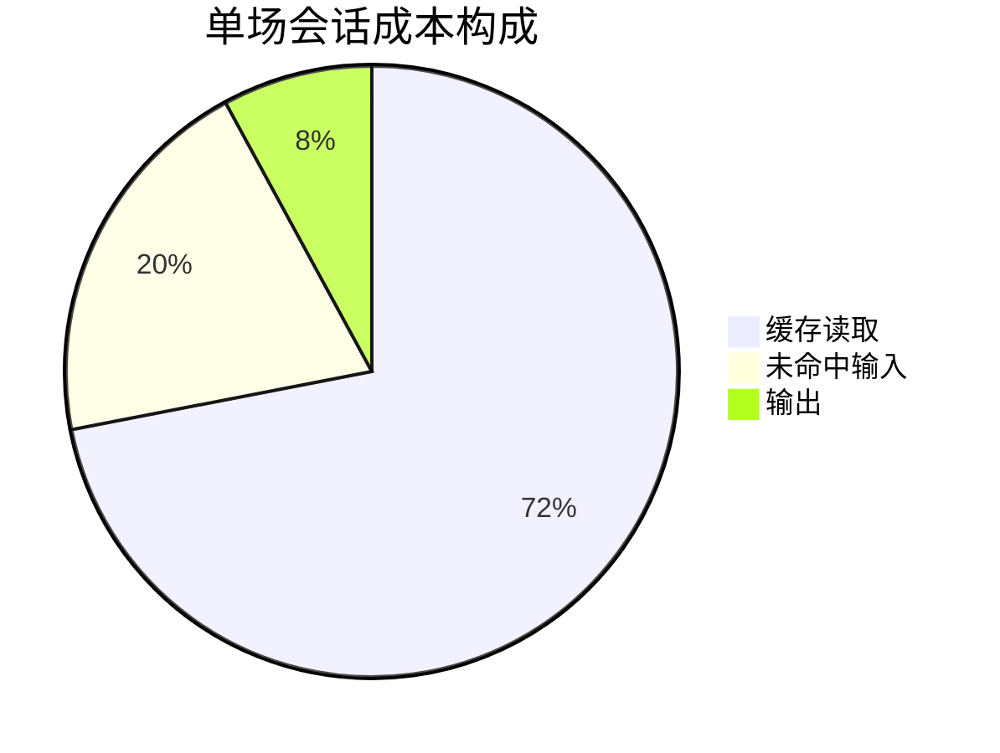

# dsh-ponytail-native 落地后提供的能力清单

> 配套 `DESIGN.md`。本文只回答「装好之后我多拿到了什么」，不讲实现。
> 前提：方案按 DESIGN.md 完整落地（Phase 0~3，约 3~3.5 人日）。**当前未实现、未安装。**

---

## 1. 三类能力，一句话概括

| 类别 | 一句话 |
|---|---|
| **用起来爽** | 5 个交互入口，随时切强度、随时调专门技能，全部零 token 或按需加载 |
| **模型变样** | 每一步都带着「最小完整改动」的规则：先算清影响面，再写；砍掉没被要求的东西，但不砍校验/安全；结尾自报跳过了什么 |
| **能长期跟上** | 一条命令同步上游新版，有 lock 文件防腐化，有 10 项断言防退化 |

---

## 2. 交互面：你多了 5 个入口

| 入口 | 用法 | 特性 |
|---|---|---|
| **命令切档** | `/ponytail` 看状态；`/ponytail lite` / `full` / `ultra` / `off` 切档 | **不发给模型、零 token、下一步立即生效** |
| **输入框下拉** | 输入框工具栏上的档位选择器，显示当前档 | DSH 原生外观，与 `/skill` 选择器同一套接缝 |
| **设置页** | 总开关 + 默认档位（可选：6 个技能逐一开关） | 重启 DSH 后仍记住 |
| **技能手势** | `/ponytail-review`、`/ponytail-audit`、`/ponytail-debt`、`/ponytail-gain`、`/ponytail-help` | 正文按需注入，不用时不占上下文 |
| **自然语言** | "stop ponytail" / "normal mode"（**仅当整条消息就是这句**才生效） | 防误触发：说"加个 normal mode 开关"不会真关掉 |

注：`/ponytail` 这个短名归命令用（DSH 规则是同名命令优先于技能手势），核心规则本身已常驻，不需要手动加载。

---

## 3. 模型行为：四档强度 + 四条铁律

### 四档

| 档位 | 模型会怎么变 |
|---|---|
| **off** | 完全无感，等于没装（但技能仍可手动调） |
| **lite** | 照你说的做，一句话点出"还有个更小的做法"，由你选 |
| **full（默认）** | 六阶阶梯逐级试探：平台原生 → 标准库 → 仓库已有 → 已装依赖 → 一行 → 最小代码 |
| **ultra** | 在 full 之上**额外质疑需求本身**：动工前对没有依据支撑的部分提出反对 |

⚠️ 这里刻意与 HB123X 版**相反**：HB 的 ultra 是"永不追问需求是否必要，直接给最短"。本方案按上游——**ultra 是更会拦，不是更会写**。

### 四条不随档位改变的铁律

1. **先算影响面**（`Before you write`）：动手前列出改动要触达的每一处——调用方、测试、fixture、配置、导出；并检查会破坏用户什么。
2. **不砍这些**：信任边界的校验、防数据丢失的错误处理、安全、可访问性、用户明确要求的东西。
3. **测试反射**：非平凡逻辑（分支/循环/解析器/钱/安全/新脚本）必须留一个小测试或 assert 自检；琐碎改动不需要。
4. **豁免要留痕**：故意简化但知道有上限的，写 `shortcut: <上限>, <什么时候该升级>`。

### 输出纪律

每次回复结尾 1~2 行：**跳过了什么 / 没检查什么 / 有什么风险你知道一下**。

---

## 4. 六个技能各给你什么

| 技能 | 什么时候用 | 产出形态 |
|---|---|---|
| `ponytail` | 任何编码任务（auto 或 `/ponytail`） | 规则本身（已常驻，通常不用手动调） |
| `ponytail-review` | "评审这次改动" / "review 我这个 PR" | `What this change does:` 三句 → **Must fix / Should fix / Nice to have** 三组编号发现，每条四段：这是什么、问题、怎么修、不修会怎样 → `Verdict: fix 1 and 3 first.` → `Lean: -N lines possible.` → `Not checked:` |
| `ponytail-audit` | "审计整个仓库" / "哪些能删" | 先建图（入口、数据流、预期负载）再排序：1 先修、2 其次…末尾给"先修第几条" |
| `ponytail-debt` | "我拖了哪些债" | 一行一条台账：`文件:行, 简化了什么. ceiling: 上限. upgrade: 何时该升级.` |
| `ponytail-gain` | "这套东西到底省了多少" | 基准记分牌（39 任务 × 5 次：代码 −53%、时间 −41%、成本 −26%、输出 token −45%） |
| `ponytail-help` | 忘了怎么用 | 速查卡 |

**关键差异**：`review` 与 `audit` 是上游 v5 重写过的版本——**读的不只是 diff，还有它触达的代码**（改名后哪个没改的调用方会崩）。gong 那个移植的这两个技能还停在 v4，只有"砍过度工程"这一件事。

---

## 5. 三个日常场景

**场景 A：你说"给我加个日期选择器"**
无 ponytail → 装个库或手写日历，335 行。
有 ponytail（full）→ 先查仓库有没有现成 `Input` 组件、浏览器自带 `type="date"` → 10 行复用。结尾告诉你"没做区间选择，需要的话两个 input 拼一下"。

**场景 B：你准备合一个 PR**
`/ponytail-review` → 报出"这个改动把字段改名了，但 `src/routes/feed.js` 没跟着改，Atom feed 现在每次请求都崩"，并给出最小修法与不修的后果。

**场景 C：你只想快速出活**
`/ponytail lite` → 它不再劝你砍需求，只把更小方案一句话放旁边，你决定。

---

## 6. 维护能力（这块比现有两个移植都强）

| 能力 | 命令 | 解决什么 |
|---|---|---|
| **同步上游新版** | `bash scripts/sync-upstream.sh` | 上游发 v5.4 时一条命令跟上，而不是像 gong 那样冻结在 v4 |
| **防腐化** | `upstream.lock.json`（上游 SHA + 每文件 sha256） | 随时能判定"我们的正文有没有被手改过" |
| **防退化** | `npm run verify`（10 项断言） | 其中一条专防"ultra 语义被改回 HB 那种反转" |
| **兼容透明** | `engines.dsh` + `dshReleases` 矩阵 | 你自己就能判断能不能装，不用试 |

---

## 7. 明确的边界：不提供什么

| 不做 | 原因 |
|---|---|
| 不碰 `~/.dsh/AGENTS.md` | 那里存着你的 UI 铁律全文（4629 B）。本方案完全不依赖它，也不需要覆盖它 |
| 不注册任何 tool | 零 tool，不占你的工具槽、不改工具列表 |
| 不画 band 面板 / 状态栏 | Claude Code 专属可视化，与核心价值无关 |
| 不自动改代码 | review / audit 只出报告，一行代码都不动 |
| 不联网、不调外部 API | 纯本地规则注入 |
| 不改变模型选择 | 与模型路由无关 |

---

## 8. 成本账（实测版，非上游宣传）

### 8.1 新增的常驻成本（本机实测）

| 项 | 实测值 | 说明 |
|---|---|---|
| 基线文本 `full` | **2822 字符 ≈ 706 token** | 复刻上游模式过滤后实测 |
| 基线文本 `lite` | 2877 字符 ≈ 719 token | |
| 基线文本 `ultra` | 2890 字符 ≈ 722 token | |
| 基线文本 `off` | **0** | 段落消失 |
| 技能目录 | ≈400 token | 6 个技能描述合计 1584 字符 |
| 每步代价 | ≈0 | 文本不变 → 前缀不变 → 命中缓存 |

### 8.2 省钱到底能省多少（用本机真实会话算）

取本机一场 79 步 / 5 轮的编码会话（RPA 工作区，从 `session.jsonl.zstd` 的 `assistant/chunk` usage 事件汇总）：

| 项 | 数值 | 占总量 |
|---|---|---|
| `inputTokens`（未命中缓存） | 659,848 | 2.7% |
| `cacheReadTokens`（命中缓存） | 23,616,512 | **97.0%** |
| `outputTokens` | 64,632 | **0.27%** |
| `reasoningTokens` | 20,500 | 0.08% |
| 合计 | 24,340,992 | |

按典型单价折算（未命中输入 1×、缓存命中 0.1×、输出 4×），单场成本约 ¥6.56，构成：



**三个反直觉结论**：

1. **输出 token 只占成本 7.9%**。就算输出降 45%，也只省 **3.6%**，不是 26%。
2. **加 706 token 的常驻规则，成本 ≈ +0.17%**（走缓存，几乎白送）。
3. **真正的省钱杠杆是「少一步」，不是「少写一个字符」**：本场每多一轮，就多读一遍约 30 万 token 的上下文（≈¥0.083/步）；**砍掉 22% 的步数 ≈ 省 22%**，而砍掉 100% 的输出才省 7.9%。

所以上游那句"成本 −26%"**在机制上是对的，但归因不是"代码写少了"，而是"轮次少了 22%"**——少返工、少来回、少重写，每次省掉一整遍长上下文的重读。

### 8.3 诚实的预期

| 目标 | 判定 | 置信度 |
|---|---|---|
| 代码更精炼 | **能**，这是主收益 | 高（行为引导，方向明确） |
| 输出 token 更少 | 能，但**对总成本影响小** | 中高 |
| 总 token 更少 | **几乎无感**（输出仅占 0.27%） | 高 |
| 单场成本更低 | **约 1~4%**（若只影响输出） | 中 |
| 省大钱 | 仅当**减少轮次/返工**时成立，可达 ~20% | 中（上游实测 turns −22%） |

⚠️ 上游 −53%/−45%/−26% 是 **Claude Code + Opus 5.5**、39 任务 × 5 次 × 3 臂的几何均值（有 bootstrap 区间），**不能直接搬到 deepseek-v4-flash + DSH**。本机 input:output 高达 375:1，与上游基准的任务形态差异很大。

### 8.4 被忽略的长期收益（这条才是真值钱）

代码少 50% → 以后每次读代码、grep、重构的上下文都小一半 → **每场会话的输入成本都降** → 这是**复合收益**，不在单场 A/B 里体现。对本机这种"缓存读取占成本 72%"的形态，长期复利远大于单场省下的几个百分点。

### 8.5 怎么验证（可执行，不靠感觉）

DSH 会话日志已记录完整 usage，可直接复算，无需埋点：

```bash
# 每场会话的 input / cacheRead / output / reasoning 汇总
/usr/bin/python3 - <<'PY'
import glob,json,zstandard,os
p=sorted(glob.glob(os.path.expanduser("~/.dsh/sessions/*/*/session.jsonl.zstd")))[-1]
raw=zstandard.ZstdDecompressor().stream_reader(open(p,'rb')).read().decode('utf8','replace')
i=o=cr=r=0
for l in raw.splitlines():
    if '"usage"' not in l: continue
    u=json.loads(l).get('data',{}).get('chunk',{}).get('usage')
    if u: i+=u.get('inputTokens',0); o+=u.get('outputTokens',0)
    if u: cr+=u.get('cacheReadTokens',0); r+=u.get('reasoningTokens',0)
print(f"input={i:,} cacheRead={cr:,} output={o:,} reasoning={r:,}")
PY
```

**A/B 协议**（落地后跑，成本约几块钱）：

1. 选 **5 个你自己的真实小任务**（10~50 行改动的量级）。
2. 每个任务跑两遍：`/ponytail off` 一次、`/ponytail full` 一次，**各自新开会话**避免串味。
3. 记录：步数、output token、新增行数、是否漏改调用方、是否跑过测试。
4. **判定通过**：≥4/5 任务新增行数降 ≥20%，且**漏改调用方 0 次**、测试全绿。
5. **判定失败**（该关掉或换档）：出现 ≥2 次漏改调用方 / 引入回归 bug；或步数不降反升（说明"先查已有"反而花了更多轮）。

第 5 条里的"步数不降反升"是本方案最真实的风险：ponytail 要求"先查仓库里有没有现成的"——这在弱模型上可能**增加**工具调用轮次，而每多一轮就要多读一遍长上下文，**可能把省下的输出全吃掉还倒亏**。这条必须实测，不能假设。

---

## 9. 与现有环境的关系

- **与 UI 铁律并存**：ponytail 要求"最短 diff"，铁律要求跑 `verify_ui.py` 拿 PASS。基线文本里会显式写入一条优先级条款——**工作区指令（AGENTS.md）与本块冲突时以工作区为准**。所以门禁不会被"懒惰"绕过去。
- **与现有 40+ 插件并存**：单 section、零 tool、`/ponytail` 前缀独占，无路由或命名冲突。
- **可随时卸载**：`dsh plugin remove` 后只剩 `$DSH_HOME/ponytail/config.json` 一个状态文件。
