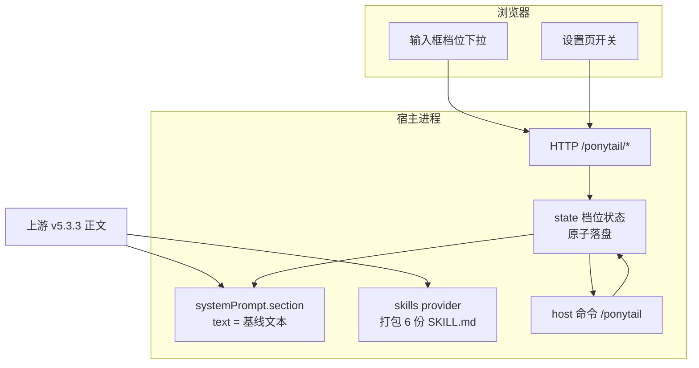

# dsh-ponytail-native 设计方案 v1

> 目标：在 DSH 上**完整复刻上游 ponytail v5.3.3 的行为与核心价值**，同时给出**DSH 原生体验**（每步生效、即时切档、原生 UI），并吸收 `HB123X/dsh-ponytail` 与 `gongyijie85/dsh-ponytail` 两个移植里真正值得拿的东西。
>
> 状态：**设计稿，未实现、未安装**。所有"已验证"结论均来自本机 DSH 0.1.2-alpha.2 源码核对；标 ⚠️ 的是必须在 Phase 0 真机打通的未知项。

---

## 0. 一句话结论

现成两个移植各缺一半，**不能靠组合它们凑出目标**：gong 只有技能、没有实时档位（且内容停在 v4）；HB 有实时档位、但技能全无、规则被重写且方向做反。本方案 = **gong 的"技能随包分发 + 宿主平面注册"** + **HB 的"每步求值 + UI 开关 + 持久化"** + **上游 v5 的正文与语义逐字保留** + **DSH 官方受控接缝（而非手工 CSS/硬编码 order）**。

---

## 1. 目标与非目标

### 目标（必须达成）

| # | 目标 | 验收方式 |
|---|---|---|
| G1 | 6 个技能与上游 v5.3.3 **逐字节一致** | `upstream.lock.json` 的 sha256 全等 |
| G2 | 规则集**每步**进入上下文，非仅在会话首次 | 切档后下一步立即生效 |
| G3 | `off/lite/full/ultra` 四档，**即时切换 + 持久化** | 命令/下拉切换后重启仍在 |
| G4 | **ultra = 反问需求**（不做 HB 的"别问直接写"反转） | 基线文本断言 |
| G5 | 保住上游必留四要点：`Before you write` scope 清单、六阶阶梯、`shortcut:` 约定、`Never cut` 四类 | 基线文本断言 |
| G6 | DSH 原生入口：**host 命令 + 输入框下拉 + 设置页开关** | 三者改同一份 state |
| G7 | 不碰 `~/.dsh/AGENTS.md`、不在 `$DSH_HOME` 根撒文件 | 安装前后 diff |
| G8 | 兼容性**实测后**声明，不猜 | `dsh.compatibility.dshReleases` 有对应键且真机通过 |

### 非目标（明确不做）

- **band 面板 / statusline 脚本**：Claude Code 专属的可视化，与"核心价值"无关，DSH 无对应面。
- **重写规则文本**：不创作、不"优化"上游文案（HB 的教训）。
- **qoder/cursor 等其它宿主适配**：上游已覆盖 20+ 宿主，本包只做 DSH。
- **把 6 个技能再包一层 tool**：零 tool 是 gong 的正确决定，保持。

---

## 2. 上游能力 → DSH 实现对照（复刻矩阵）

这是"完整复刻"的定义表。每一行都要在验收时逐条过。

| 上游能力 | 上游做法 | 本方案在 DSH 的做法 | 状态 |
|---|---|---|---|
| 规则集常驻 | `UserPromptSubmit` hook 每轮注入 | `ctx.systemPrompt.section({ text: () => 当前档位文本 })`，每次组装重算 | ✅ 已验证接缝 |
| 6 个技能 | 插件 `skills/` + 各宿主发现 | `ctx.skills.registerProvider` 注册打包的 `skills/` | ✅ 已验证接缝 |
| `lite/full/ultra` | `/ponytail lite` 改 flag 文件 | `commands.register('ponytail')` + 输入框下拉 | ✅ 已验证接缝 |
| 档位默认值 | `PONYTAIL_DEFAULT_MODE` > config > `full` | 同解析链，扩展 profile 层 | ✅ |
| 档位持久化 | `~/.config/ponytail/config.json` | `$DSH_HOME/ponytail/config.json`（原子写） | ✅ |
| `off` 关闭 | flag=off → 注入空串 | 基线 `text` 返回 `''` → 段落消失 | ✅ |
| `stop ponytail` / `normal mode` | `isDeactivationCommand`：**整条消息等于命令**才生效 | 复刻同一判定（防"加个 normal mode 开关"误关） | ⚠️ 需前置文本钩子；否则退化为 `/ponytail off` |
| 子代理继承 | `SubagentStart` hook + `PONYTAIL_SUBAGENT_MATCHER` | 依赖 section 是否随 agent 作用域继承 | ⚠️ Phase 0 验证 |
| 每轮注入 | 每轮重发全文 | 每步求值但**内容不变时前缀不变**（缓存友好） | ✅ 优于 HB 手写 |
| level 过滤技能正文 | `filterSkillBodyForMode` 只留当前档 | 技能正文保留完整 Levels 表（自解释）；档位以基线块显式声明 | 语义等价、实现更简单 |
| 斜杠四技能 | `/ponytail-review` 等 | DSH `/name` 手势注入技能正文 | ✅ 已验证 |
| 状态栏 badge | statusline 脚本 | 输入框下拉按钮上显示当前档（原生槽位） | 等价替代 |
| band 面板 | Claude 专属 | 不做 | 非目标 |
| 版本/许可声明 | — | `engines.dsh` + `dshReleases` 矩阵 + LICENSE 双署名 | ✅ 采自 gong |

---

## 3. 架构



四个宿主面共用一个 `state.js`；`baseline.js` 从 `skills/ponytail/SKILL.md` **派生**四档文本（单一真相源，避免"两处写同一逻辑"）。

---

## 4. 关键设计决策（ADR 摘要）

### D1 注入用 `systemPrompt.section`，不用每步重写消息

`PromptSection.text` 类型是 `string | ((context) => string)`（`packages/core/system-prompt/src/index.ts:66`），每次组装求值。

- **好处**：切档后下一步立即生效（满足 G2），且文本不变时提示前缀不变 → **不破坏 KV 缓存**。
- **优于 HB 之处**：HB 把 `order: 150` 写死。DSH 有受控段位表 `SECTION_ORDERS`（`DEPLOYMENT_PERSONA: 0`、`PLAN_POLICY: 500`…见 `src/index.ts:121-152`），本方案取 **order = 10**，语义为"人设之后、计划策略之前"，并在文档里写明理由，不用魔数 150。

### D2 档位切换双入口，且命令**不发给模型**

`CommandDefinition`（`packages/interaction/commands/src/index.ts:55`）明确："Execute against the receiving agent without sending the command to the model"。

- `/ponytail ultra` → 零 token、零延迟、即时生效，**这才是上游的原样 UX**，也是 HB 完全缺失的。
- 输入框下拉走 `inputTriggers.registerSource`（DSH 自己的 `/skill` 选择器就用它），**不手写 CSS**——HB 那 244 行手拼 React + 内联样式是最大脆弱点。
- ⚠️ **命名冲突必须处理**：DSH 规则是「同名 host 命令优先于技能手势」（`packages/client/ui-skill/src/client/index.ts:180` 注释）。所以 `/ponytail` 被命令占用；`/ponytail-review`、`/ponytail-audit` 等**没有**同名命令，仍是技能手势，不受影响。无参 `/ponytail` = 报告当前档位（而不是加载技能正文），核心技能正文由基线块常驻，损失可接受；需要正文时模型用 `skill` 工具。

### D3 技能：宿主平面 provider + 逐字节 v5

- `ctx.skills.registerProvider((control) => ({ name, list, get }))`，形状与 `SkillProvider` / `SkillDefinition` 契约逐字段吻合（已核对 `packages/skill/skill/src/index.ts:249`、`:87`）。
- 注册在**宿主平面**，所有 agent preset 的 scope 链都能合并到 → 6 技能对所有会话可见。
- `description: >` 折叠式 frontmatter **不需要展平**：DSH 用真 YAML 解析，且六份描述 141~370 字符均在 `catalogDescriptionMaxLength = 500` 上限内（`packages/skill/tool-skill/src/index.ts:27`）。gong 早期 CHANGELOG 说"必须展平"是错的，后期 `sync-upstream.sh` 已自我纠正。

### D4 档位语义忠实上游，明确修掉 HB 的反转

| 档位 | 上游 v5.3.3 | HB 的反转（不采纳） |
|---|---|---|
| lite | 构建所求，一句话点出更小的选项让用户选 | 大致相同 |
| full | 完整规则 | 删掉 `Before you write` |
| ultra | **同时质疑需求：动工前对无据支撑的部分提出反对** | **"永不追问需求是否必要，直接给最短"** ← 语义相反 |

HB 的 README 自认改向（"核心目标是省 token，而不是反驳用户需求"）。本方案按上游：**ultra 是"更会拦"，不是"更会写"**。

### D5 反误触发复刻上游已验证的坑

上游 `hooks/ponytail-config.js` 里 `isDeactivationCommand` 要求**整条消息**（去尾标点、忽略大小写）等于 `stop ponytail` / `normal mode`，注释写明原因：早期按子串匹配会把"add a normal mode toggle"这类正常请求误判成关闭。这条必须复刻。

### D6 持久化：分级 + 原子写，不污染 home 根

解析顺序（高 → 低）：

1. 环境变量 `PONYTAIL_DEFAULT_MODE`
2. profile 级 patch config（`cordis.patch.yml` 里本插件的 `config`）
3. `$DSH_HOME/ponytail/config.json`
4. 默认 `full`

- **弃用 HB 的 `~/.dsh/dsh-ponytail.json`**（直接躺在 home 根）。
- 写盘用 `临时文件 + rename` 原子替换；读损坏时 salvage 到默认值并告警，不抛异常打断宿主启动。

### D7 兼容性实测后再声明

采 gong 的 `engines.dsh` + `dsh.compatibility.dshReleases` 矩阵，但**每加一个键必须真机跑过 verify**。首版只标本机实测过的版本，其余留空（不写"约定俗成"的 compatible）。

### D8 可执行验收

`npm run verify` 必须覆盖 10 项（见 §7），且 CI 三平台跑同一套。

### D9 工作区指令优先（DSH 原生谦让）

基线文本末尾**必须**固定写入一段优先级条款，大意：*当工作区指令（`AGENTS.md` / 项目规则）与本块冲突时，以工作区指令为准；本块不得被用作跳过工作区门禁的理由。*

- **为什么必须有**：本机 `~/.dsh/AGENTS.md` 里有强制门禁（UI 铁律要求 `verify_ui.py` 出 PASS）。ponytail 的核心是"最短 diff、删优先"，与"必须跑门禁脚本"表面冲突。若不显式谦让，模型可能拿"懒惰"当借口跳门禁。
- 上游没有这条（它的宿主通常没有硬门禁）；这是本方案针对 DSH 真实环境补的**第 9 条设计决策**。
- 验收断言里加一条：`full` 与 `ultra` 基线都必须包含该优先级条款（防后续 sync-upstream 覆盖掉）。

---

## 5. 从两个项目采纳/不采纳

### 采自 gongyijie85

| 采纳 | 理由 |
|---|---|
| `ctx.skills.registerProvider` + 随包 `skills/` | 唯一正确的技能分发方式，且宿主平面可见 |
| `engines.dsh` + `dshReleases` 兼容矩阵 | 让用户能自己判断能不能装，比"自行体会"强 |
| `scripts/verify-provider.mjs` 冒烟（6/6） | 可执行验收的起点 |
| `scripts/sync-upstream.sh` | **最高价值**：把"跟上上游"变成一条命令 |
| `dsh.plugin.json`（contributes 清单） | 声明式贡献面，便于审计 |
| CI + CHANGELOG 纪律 + 双语 README | 工程完整度 |

### 采自 HB123X

| 采纳 | 理由 |
|---|---|
| `systemPrompt.section` 每步求值 | 满足"每步生效"的关键机制 |
| 输入框档位下拉 + 设置页总开关 | 真正的 DSH 原生体验 |
| `GET /ponytail/state` `POST /ponytail/mode` `POST /ponytail/enabled` | 宿主↔浏览器最小契约，且带 400 校验 |
| 档位枚举含 `off` | 需要一个彻底关断 |
| 持久化思路 | 但改位置与写法（见 D6） |

### 明确不采纳

| 不采纳 | 原因 |
|---|---|
| HB 重写的 `RULESET` 文本 | 丢掉 scope 清单、反转 ultra；上游文案是核心资产 |
| HB 手写 CSS/React picker（244 行） | 脆弱、与主题易漂移；应走 `inputTriggers` 原生接缝 |
| HB 的 `order: 150` 魔数 | 用受控段位语义位替代 |
| HB 的 home 根状态文件 | 挪进 `$DSH_HOME/ponytail/` |
| HB 的 Windows/Electron/`desktop` profile 假设 | 本机是源码版 + `web` profile + macOS |
| gong 的**技能正文**（v4 2026-06-19 快照） | 与上游 5.3.3 相似度仅 3.6%/4.1%，review/audit 方法论整个被换掉 |
| gong 的"仅技能、无实时档位" | 不满足 G2/G3 |

---

## 6. 文件结构与契约

```
dsh-ponytail-v5/
├── package.json            # dsh.bundle.patch / dsh.client / engines.dsh / compatibility
├── dsh.plugin.json          # 贡献面清单（采 gong）
├── cordis.patch.yml         # insert: [{id: ponytail, name: <pkg>}]
├── lib/
│   ├── index.js             # apply / inject / name（宿主入口）
│   ├── state.js             # 档位解析链 + 原子持久化
│   ├── baseline.js          # 从 skills/ponytail/SKILL.md 派生四档文本
│   ├── provider.js          # skills provider（list/get）
│   ├── command.js           # commands.register('ponytail')
│   └── client.js            # 浏览器半：inputTriggers 下拉 + 设置页
├── skills/                  # 6 份，逐字节 v5.3.3
│   ├── ponytail/SKILL.md
│   ├── ponytail-review/SKILL.md
│   ├── ponytail-audit/SKILL.md
│   ├── ponytail-debt/SKILL.md
│   ├── ponytail-gain/SKILL.md
│   └── ponytail-help/SKILL.md
├── scripts/
│   ├── record-lock.mjs      # 记录 upstream SHA + 各文件 sha256
│   ├── sync-upstream.sh     # 拉上游 → 覆写 skills/ → 重算 lock → 跑 verify
│   └── verify.mjs           # 10 项断言
├── upstream.lock.json       # {upstreamSha, version, files:{path:sha256}}
└── docs/{DESIGN.md, PARITY.md, RELEASE.md}
```

### 对外契约

**HTTP**（前缀注册，host 面 handler 是 Node 原生 `(req,res)`）

| 方法 | 路径 | 语义 | 校验 |
|---|---|---|---|
| GET | `/ponytail/state` | 返回 `{enabled, mode, source}` | — |
| POST | `/ponytail/mode` | 切档 | `mode ∈ {off,lite,full,ultra}`，否则 400 |
| POST | `/ponytail/enabled` | 总开关 | `enabled` 必须 boolean，否则 400 |

**Host 命令**

`/ponytail [lite|full|ultra|off|status]` — 无参 = `status`。不发给模型、不产生 token。

**Prompt section**

`{ name: 'plugin:dsh-ponytail', order: 10, text: () => enabled ? baselineFor(mode) : '' }`

**Skills provider**

`name: 'dsh-ponytail-native'`；`list` 返回 6 个候选；`get` 返回符合 `SkillDefinition` 的对象（含 `resourceBase: {kind:'directory', path}`）。

---

## 7. 验收清单（`npm run verify` 必须全绿）

1. 六份 SKILL.md 的 sha256 与 `upstream.lock.json` 全等（G1）
2. 六份 `name` 合法 kebab-case、与目录同名（DSH `SKILL_NAME` 规则）
3. 六份 `description` 展平后 ≤ 500 字符（DSH 目录上限）
4. provider `list()` 返回 6 条，`get()` 对每条返回非空 `content`
5. `baselineFor('off') === ''`；`lite/full/ultra` 三份互不相同
6. full 基线包含 `Before you write`、`shortcut:`、`Never cut` 三类关键词
7. ultra 基线包含"质疑需求"语义、**不含** `never ask whether the requirement is needed`（防回归到 HB）
8. 档位解析链：env > profile config > 文件 > `full`，四级各断言一次
9. `isDeactivationCommand`：`"stop ponytail"` / `"normal mode."` 为真；`"add a normal mode toggle"` 为假
10. 命令解析：`/ponytail` 无参 → status；四个合法档位 → 对应切换；非法参 → 明确报错不静默

---

## 8. 分期与工作量

| 阶段 | 内容 | 产出 | 估时 |
|---|---|---|---|
| **Phase 0** | 5 项未知 API 真机探针（见 §9） | `probe-report.md` + 每个 ⚠️ 有结论 | 0.5d |
| **Phase 1** | 核心：provider + 基线 section + state + host 命令（**无 UI 已可用**） | verify 1-4、8-10 全绿 | 1d |
| **Phase 2** | UI：输入框下拉（`inputTriggers`）+ 设置页 + 档位徽标 | verify 全绿 + 真机录屏 | 1d |
| **Phase 3** | 发布工程：`upstream.lock` + `sync-upstream.sh` + CI 三平台 + 兼容矩阵实测 + 双语 README | 可发 npm / 可 `dsh plugin add` | 0.5d |
| **Phase 4**（可选） | 子代理注入、`stop ponytail` 前置钩子、per-skill 开关 | 对上游 parity 补齐 | 0.5d |

**总计约 3~3.5 人日**。Phase 1 结束即"能用的 80%"，Phase 2 才叫"原生体验"。

---

## 9. 未知项与风险（Phase 0 必须先打）

| # | 未知 | 影响 | 备用方案 |
|---|---|---|---|
| R1 | `systemPrompt.section` 是否随 agent 作用域传给**子代理** | 子代理是否继承规则（上游有 SubagentStart） | 在技能正文里补一句"子代理同样遵守"；或接受降级 |
| R2 | 第三方插件能否在 `agent/pre-step` 往 inbox 追加 user 消息 | 决定能否复刻 `stop ponytail` 文本触发 | 退化为 `/ponytail off` 命令 |
| R3 | `InputTriggerSource` 完整形状与「非斜杠的输入框工具栏」槽位 | 下拉能否做成原生外观 | 先用 host 命令 + 设置页，工具栏后补 |
| R4 | 设置页组件注册的确切接缝（settings + ui-primitives） | 设置页能否零 shim 挂上 | 参照本机 `dsh-skill-studio` / `dsh-feishu` 已跑通的写法 |
| R5 | 包名是否与 npm 现有包冲突 | 能否发布 | 先只做 `github:` / `file:` 安装 |
| R6 | 0.1.2-alpha.2 与 0.2.x 的 section/provider API 差异 | 跨版本可用性 | 兼容矩阵只标实测通过的版本 |

**R1/R2/R4 是本方案的技术赌点**，但每一个都有明确降级路径，不会导致方案不可行。

---

## 10. 与"直接装现成的"对比

| 方案 | 技能齐全 | 内容为 v5 | 每步生效 | 即时切档 | 原生 UI | 兼容声明 | 工作量 |
|---|---|---|---|---|---|---|---|
| 装 gong | ✅ | ❌ v4 | ❌ | ❌ | ❌ | ✅ | 0 |
| 装 HB | ❌ | ❌ 重写 | ✅ | ✅ | ⚠️ 手写 | ❌ | 0 |
| gong + 跑 sync-upstream | ✅ | ✅ | ❌ | ❌ | ❌ | ✅ | 0.1d |
| **本方案** | ✅ | ✅ | ✅ | ✅ | ✅ | ✅ | 3~3.5d |

**如果只想要"技能 + v5"且不在乎实时切档**：装 gong 再跑它的 `sync-upstream.sh` 是 0.1 人天的性价比之王。
**本方案的价值在**：把"每步生效 + 即时切档 + 原生 UI"这三件 DSH 独有能力补齐，并且用官方接缝实现，可长期跟上上游。

---

## 11. 合规与署名

- 上游 `DietrichGebert/ponytail` 为 **MIT**，HB / gong 两个移植也是 MIT → 代码与文案均可直接复用，只需保留版权与许可声明。
- LICENSE 需**双署名**：`© DietrichGebert (upstream ruleset & skills)` + 本包作者。
- 本包与原版**无隶属关系**，README 顶部标明"非官方 DSH 移植"。
